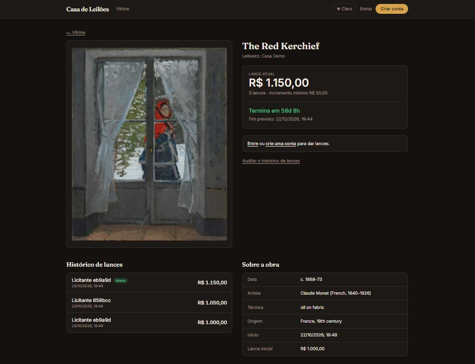
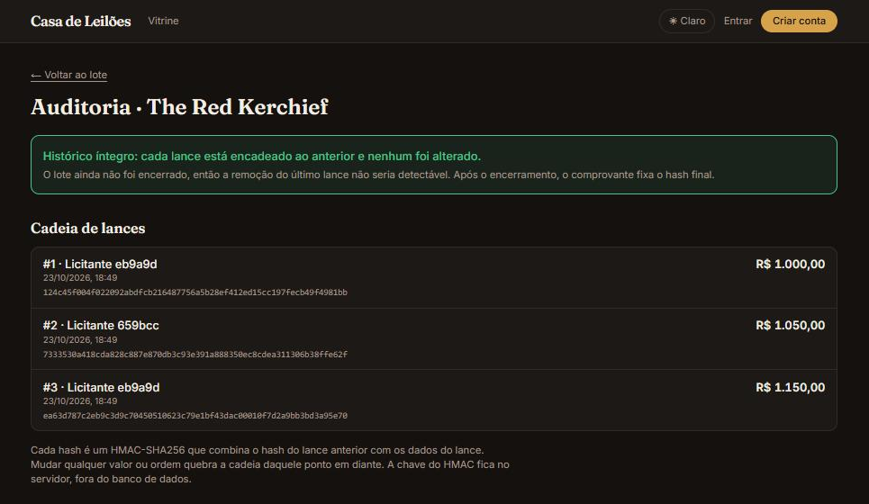

# Casa de Leilões Online

Teste técnico Elite Dev (Verzel): leilões online com lances ao vivo, carteira simulada, liquidação automática e auditoria pública do histórico de lances.

- **Site:** https://verzel-leiloes-teste.vercel.app
- **API:** https://leilao-api-x898.onrender.com (`/health` para checar)
- **Tema:** obras de arte do acervo aberto do Cleveland Museum of Art (domínio público, CC0).

> **Primeira visita lenta.** A API roda no plano gratuito da Render, que dorme depois de cerca de 15 minutos sem uso. A primeira chamada depois disso pode levar até ~50 segundos. Se a vitrine demorar, aguarde e recarregue.

## Telas

**Vitrine:** lotes ao vivo, agendados e encerrados, com busca por título ou artista.


**Sala do lote:** lance atual, contagem regressiva, histórico com apelidos e dados da obra. Quem está logado como licitante vê aqui o campo de lance e se está ganhando ou foi superado.



**Auditoria pública:** cadeia de lances com o hash de cada um e o veredito de integridade, sem precisar de login.



## Contas de demonstração

Criadas pelo seed. A senha de todas é `demo12345`.

| Papel | E-mail | Observação |
|---|---|---|
| Leiloeiro | `leiloeiro@leiloes.dev` | cria e cancela lotes |
| Licitante | `ana@leiloes.dev` | saldo inicial R$ 50.000,00 |
| Licitante | `bruno@leiloes.dev` | saldo inicial R$ 50.000,00 |

O seed cria 5 lotes: 3 ao vivo (um deles com lances em aberto), 1 agendado e 1 encerrado com comprovante e auditoria.

## Stack

| Camada | Tecnologia |
|---|---|
| Front | Next.js 16 (App Router), React 19, Tailwind v4, TypeScript |
| API | Node 22, Express 5, TypeScript, `pg`, `zod`, `jsonwebtoken` |
| Banco | PostgreSQL (Neon em produção, Docker local) com migrações SQL próprias |
| Testes | Vitest + Supertest (API), Vitest (web) |
| CI | GitHub Actions: lint, typecheck, testes e build |
| Deploy | Vercel (web), Render com Docker (API), Neon (banco) |

Monorepo com npm workspaces: `apps/api` e `apps/web`.

## Como rodar localmente

Requisitos: Node 22+ e Docker.

```bash
# 1. banco
docker compose up -d db

# 2. dependências
npm ci

# 3. migrações e dados de demonstração
npm run migrate -w apps/api
npm run seed -w apps/api

# 4. em dois terminais
npm run dev:api   # http://localhost:3333
npm run dev:web   # http://localhost:3000
```

### Tudo com Docker

```bash
docker compose up --build
```

Sobe o banco, a API e o front: web em http://localhost:3000, API em http://localhost:3333. No primeiro start a API aplica as migrações e carrega os dados demo (`SEED_ON_START=1`). A ordem é garantida por healthchecks (banco, depois API, depois front) e as imagens são multi-stage, rodando sem root. Se a porta 3000, 3333 ou 5432 estiver ocupada, pare o que a usa antes.

O front embute a URL da API na hora do build (`NEXT_PUBLIC_API_URL`, em `docker-compose.yml`). Os segredos do compose são só de uso local; para outros valores, exporte `JWT_SECRET` e `HASH_SECRET` no terminal.

Para só o banco (e rodar API e front pelo Node, como acima): `docker compose up -d db`.

Não precisa criar arquivo `.env` para rodar local: a API não lê `.env` e usa valores padrão de desenvolvimento (banco em `localhost:5432`, segredos de desenvolvimento, CORS aberto), e o front usa `http://localhost:3333`. Para mudar algo, defina a variável no terminal antes do comando. Os arquivos `.env.example` listam os nomes.

### Variáveis de ambiente

API:

| Variável | Para que serve |
|---|---|
| `DATABASE_URL` | conexão com o Postgres |
| `CORS_ORIGIN` | origens do front permitidas, separadas por vírgula |
| `JWT_SECRET` | assina os tokens de login |
| `HASH_SECRET` | chave do HMAC da cadeia de lances (veja abaixo) |
| `PORT` | porta da API (padrão 3333) |
| `SEED_ON_START` | com `1`, o container carrega os dados demo ao iniciar (idempotente) |

Em produção `JWT_SECRET` e `HASH_SECRET` são obrigatórios; em desenvolvimento há valores padrão.

Front: `NEXT_PUBLIC_API_URL`, a URL da API.

### Testes e qualidade

```bash
npm test          # API (90 testes) e web (19 testes)
npm run lint
npm run typecheck
npm run build
```

Os testes da API precisam do Postgres do Docker. Eles criam e migram sozinhos um banco isolado, `leilao_test`, e não tocam nos dados de desenvolvimento.

## Roteiro para testar cada função

Use o site publicado ou o ambiente local. As contas estão na tabela de demonstração acima. Para ver o tempo real, abra duas janelas, uma anônima, com contas diferentes.

| Função | Onde | Como simular |
|---|---|---|
| Vitrine e busca | `/` | Alterne entre Ao vivo, Agendados e Encerrados e use o campo de busca por título ou artista. Lotes cancelados não aparecem. |
| Cadastro e login | `/cadastro`, `/login` | Crie uma conta de licitante ou de leiloeiro. O olhinho mostra ou oculta a senha. |
| Criar lote | `/painel` (leiloeiro) | Busque uma obra (ex.: `monet`), escolha, defina lance inicial, incremento, início e fim, e crie. |
| Lote agendado | `/painel` | Crie um lote com início no futuro. Ele aparece em Agendados, e a sala mostra o campo de lance desabilitado ("ainda não começou"). |
| Dar lance e feedback | `/lotes/[id]` (licitante) | Dê um lance válido. Depois tente: abaixo do mínimo, de novo como líder ("já está ganhando"), e um valor maior que o saldo disponível (saldo insuficiente). Cada recusa mostra a mensagem da API. |
| Tempo real | `/lotes/[id]` em duas janelas | Dê um lance como Ana. Na janela do Bruno aparece o novo lance e "Você foi superado" sem recarregar. |
| Saldo comprometido | `/carteira` | Antes e depois de liderar um lote: o comprometido sobe, e volta quando alguém cobre o lance. |
| Depósito simulado | `/carteira` | Informe um valor, por exemplo `500,00`. |
| Anti-sniping | `/painel` + `/lotes/[id]` | Crie um lote que termine em cerca de 3 minutos, dê um lance quando faltar menos de 2 minutos: o fim avança 2 minutos e a sala avisa. |
| Liquidação e comprovante | `/painel` + `/arremates` | Crie um lote que termine em 2 a 3 minutos, dê um lance e espere. Ele passa para Encerrados, o saldo do vencedor é debitado, o leiloeiro recebe, e o comprovante aparece em Meus arremates. |
| Comprovante público | `/comprovante/[token]` | Copie o link de compartilhamento em Meus arremates e abra em janela anônima, sem login. |
| Auditoria pública | `/auditoria/[id]` (link na sala do lote) | Abra sem login. Mostra a cadeia de lances e o veredito "íntegro". |
| Detectar adulteração | banco local + `/auditoria/[id]` | Só no ambiente local: `docker compose exec db psql -U leilao -c "update bids set amount_cents = amount_cents + 100 where lot_id = '<id>' and seq = 2"` e recarregue a auditoria. Ela passa a apontar o lance onde a cadeia se rompe. |
| Cancelar lote com estorno | `/painel` + `/carteira` | Com um licitante liderando um lote, cancele-o no painel (há confirmação). O comprometido do líder é liberado e o extrato mostra "Estorno". |
| Resultado e total recebido | `/painel` | Veja o resultado de cada lote e a soma dos vendidos. |
| Modo escuro | cabeçalho | Botão de tema ao lado do login. |

## Como funciona

### Papéis

- **Leiloeiro:** busca obras no catálogo, cria lotes, cancela lotes (com ou sem lances) e acompanha resultados e total recebido. Não dá lances.
- **Licitante:** deposita saldo simulado, dá lances, arremata e recebe comprovante.
- **Visitante (sem login):** vê a vitrine, as salas, a auditoria e os comprovantes.

### Regras de lance

- Só aceita lance em lote ao vivo (entre início e fim).
- Primeiro lance: no mínimo o lance inicial. Seguintes: no mínimo o lance atual mais o incremento mínimo.
- Quem lidera não pode cobrir o próprio lance.
- Recusas voltam com HTTP 422 e mensagem em português: `lot_not_started`, `lot_ended`, `already_leading`, `below_minimum`, `insufficient_funds`.

### Saldo comprometido

`disponível = total − comprometido`. Ao liderar um lote, o valor do lance fica comprometido; ao ser superado, volta na hora. O lance só é aceito se couber no disponível.

### Anti-sniping

Um lance aceito nos últimos 2 minutos do lote **soma 2 minutos ao fim atual** (`fim = fim + 2 min`). Foi a leitura que adotei do enunciado; ela também significa que a extensão se repete a cada lance feito na janela. O front avisa quando o prazo é estendido.

### Concorrência

Cada lance roda em uma transação que trava o lote com `SELECT ... FOR UPDATE`; depois travam-se os usuários envolvidos, sempre em ordem de id para evitar deadlock. O horário usado é `clock_timestamp()`, não o de início da transação. Há testes de lances simultâneos.

### Liquidação

Ao encerrar, o vencedor é debitado, o leiloeiro creditado e o comprovante é gerado. Lote sem lances fecha sem vencedor. A liquidação é idempotente e acontece de duas formas: um job a cada 15 segundos no servidor, e de forma preguiçosa, quando alguém lê lotes, carteira ou comprovantes. Assim o resultado fica certo mesmo que o servidor tenha estado dormindo.

### Histórico à prova de adulteração

Cada lance guarda `hash = HMAC-SHA256(hash_anterior | lote | seq | licitante | valor | horário)`, com o primeiro elo ancorado em um hash inicial fixo. A chave (`HASH_SECRET`) fica fora do banco, no ambiente da API.

A auditoria pública (`/auditoria/[id]`, sem login) recalcula a cadeia inteira e diz se está íntegra ou em que lance ela se rompe. Isso detecta:

- **alteração** de um lance: o hash recalculado não bate;
- **inserção** no meio: o `seq` ou o `hash_anterior` deixam de encaixar;
- **remoção** no meio: a sequência quebra.

Quando o lote é encerrado, o comprovante guarda o **hash final**. Com isso, remover o último lance também é detectado.

**Limites, sem rodeios:**

- Antes do encerramento do lote, apagar o último lance não é detectável (ainda não há hash final fixado). A tela de auditoria avisa isso.
- Quem tiver o banco **e** a chave do HMAC consegue recalcular tudo. A proteção vale contra quem altera o banco sem ter a chave.

### Privacidade

Auditoria, histórico e comprovante mostram licitantes como `Licitante a1b2c3`, um HMAC curto por lote. Dá para ver que é a mesma pessoa dentro do lote, mas não dá para ligar o alias a uma conta nem entre lotes.

### Catálogo e resiliência

As obras vêm da API aberta do Cleveland Museum of Art, só na busca do leiloeiro (cache de 10 minutos, com cópia antiga como reserva). Ao criar o lote, o título, a imagem e os atributos são **copiados para o lote**. Por isso vitrine, sala, auditoria e comprovante continuam funcionando mesmo com a API externa fora do ar. Se a busca falhar sem cópia, o painel mostra um erro claro (`catalog_unavailable`, HTTP 503).

Eu comecei pelo Art Institute of Chicago e troquei: as imagens do CDN dele são bloqueadas quando embutidas em outro site.

### Tempo real

A sala do lote usa Server-Sent Events: o servidor só avisa "mudou" e cada cliente busca a sala de novo, então ninguém recebe dado privado de outro pelo canal. Há polling de 5 segundos como reserva (proxies que seguram o stream, conexão caída).

## API

Resumo das rotas (todas em JSON):

| Rota | Quem | O que faz |
|---|---|---|
| `POST /auth/register`, `POST /auth/login`, `GET /auth/me` | todos | cadastro, login, sessão |
| `GET /lots?status=live\|scheduled\|ended&q=` | todos | vitrine (cancelados não aparecem) |
| `GET /lots/:id/room` | todos | sala: lance atual, histórico, posição de quem está logado |
| `GET /lots/:id/events` | todos | SSE |
| `GET /lots/:id/audit` | todos | cadeia de hashes e veredito |
| `GET /receipts/:token` | todos | comprovante público |
| `POST /lots/:id/bids` | licitante | dar lance |
| `GET /wallet`, `POST /wallet/deposit` | licitante | carteira e depósito simulado |
| `GET /lots/participating`, `GET /receipts` | licitante | meus lotes e arremates |
| `GET /catalog/search?q=` | leiloeiro | busca no catálogo |
| `POST /lots`, `POST /lots/:id/cancel`, `GET /lots/mine` | leiloeiro | criar, cancelar (com estorno), resultados |

Dinheiro é sempre inteiro em centavos, nunca ponto flutuante.

## Deploy

- **Banco:** Neon. As migrações rodam sozinhas quando a API inicia.
- **API:** Render, via Blueprint (`render.yaml`) com `apps/api/Dockerfile`. `JWT_SECRET` e `HASH_SECRET` são gerados pela Render; `DATABASE_URL` e `CORS_ORIGIN` são preenchidos no painel.
- **Front:** Vercel, com o diretório raiz `apps/web` e `NEXT_PUBLIC_API_URL` apontando para a API.
- **Branches:** `main` (produção), `staging` e `develop`. O trabalho entra por PR em `develop` e é promovido para `staging` e `main`.

## Comportamentos que podem surpreender

- **Primeira chamada lenta** na API (plano gratuito da Render dormindo), como descrito no topo.
- **Cancelar lote** é possível enquanto ele não terminou, mesmo com lances. Como o dinheiro só é *comprometido* durante o leilão (nada é debitado antes da liquidação), o estorno é a liberação do valor que o líder tinha comprometido, registrada no extrato como "Estorno". O saldo total não muda, e quem já tinha sido superado não recebe nada, porque já estava liberado. Lotes cancelados somem da vitrine e da auditoria pública.
- **Depósito** é simulado, limitado a R$ 1.000.000,00 por vez, e só licitantes depositam.
- **Eventos em tempo real** vivem na memória de um único processo. Com várias instâncias da API, o aviso instantâneo só chegaria a quem estivesse na mesma instância; o polling de 5 segundos cobre o resto. Para escalar, trocaria por Postgres `LISTEN/NOTIFY` ou Redis.
- **Liquidação preguiçosa:** ler lotes, carteira ou comprovantes dispara a liquidação do que já venceu. É proposital, mas significa que essas leituras podem escrever no banco.
- **Token de login** fica no `localStorage` do navegador, o que é simples mas fica exposto a XSS. Não há recuperação de senha (fora do escopo do teste).
- **Docker Compose** sobe o banco, a API e o front. Os segredos dele são padrões locais, não os de produção.

## Uso de IA

Usei o Claude Code (Anthropic) como assistente de programação ao longo de todo o projeto. Ele escreveu a maior parte do código e dos testes, sob a minha direção. Eu defini a stack (Next.js, Vercel, Render, Neon e Docker Compose), o tema, o fluxo de branches e commits (Git flow com Conventional Commits) e o escopo, e pedi o trabalho em PRs pequenos. Eu criei as contas, cuidei dos segredos e fiz o deploy do front na Vercel; a API foi publicada na Render a partir do `render.yaml`. Os segredos (senha do banco, chaves) não passaram pelo chat nem pelo repositório.

A conferência foi feita com testes automatizados (API e web, rodando na CI), testes manuais no navegador e um roteiro de verificação rodado no site publicado. Isso pegou erros do assistente, por exemplo uma tela que esperava uma lista quando a API devolvia um objeto com `items`, e arquivos que ficaram de fora de um PR.

As decisões de arquitetura e os limites conhecidos estão neste README, por exemplo: a auditoria não detecta a remoção do último lance antes do encerramento do lote.
